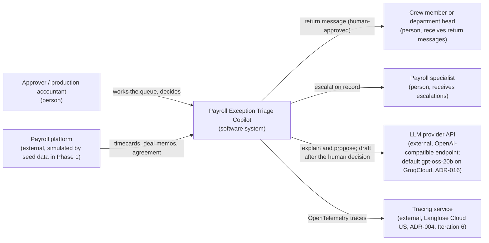
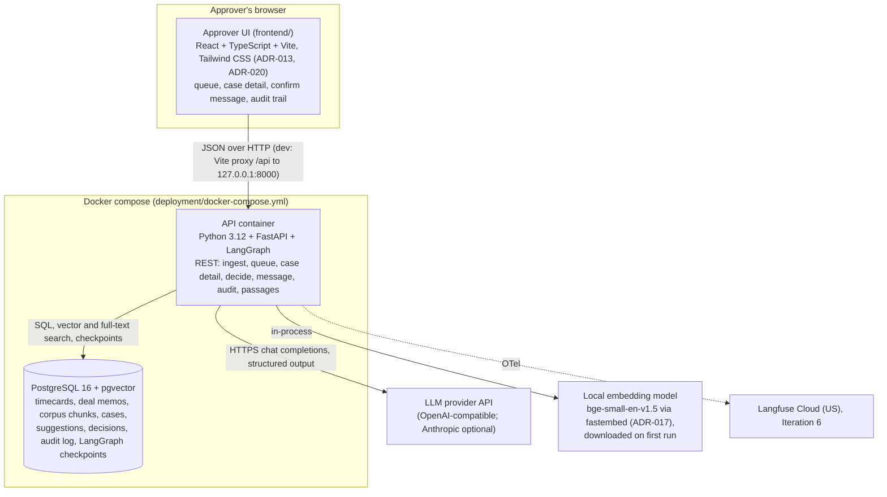

# Architecture overview

Phase 1 target architecture, updated for Iteration 2b (the vertical slice exists in code; the message is drafted after the human decision, ADR-018). Diagrams are Mermaid. Decisions referenced as ADR-NNN live in `docs/decisions/`.

## 1. C4 level 1: system context



## 2. C4 level 2: containers



The approver UI (Iteration 4) has four hash routes: the queue (`#/`), the case detail (`#/cases/{id}`), the message confirmation (`#/cases/{id}/message`) and the executed view with the audit trail (`#/cases/{id}/audit`). It has no state of its own beyond the screen: every value comes from the API, and its only requests that change state are `POST /ingest` (runs the graph up to the human checkpoint) and `POST /cases/{id}/decide` and `POST /cases/{id}/message` (the two human checkpoints), the last two carrying the approver's self-asserted actor (OD-10). It shows LLM text only when that output validated and the case is not in `needs_human_review`; a draft that needs review is not shown and the message body starts empty. The read-only display fields it needs (`GET /context`; on `GET /queue` the employee id, occupation and rule titles; on `GET /cases/{id}` the finding days as HH:MM times, the fact units, the rule titles and the occupation title) are added by `api/app.py` without changing existing fields.

Container responsibilities:

| Container | Deterministic or LLM | Writes to the database |
| --- | --- | --- |
| API (FastAPI, hosts the graph) | orchestrates both | through the case store only: cases, suggestions, decisions, effects, audit entries, checkpoints |
| PostgreSQL | n/a | n/a |
| LLM provider | LLM | nothing (no database handle) |
| Local embedding model | deterministic | nothing (vectors are written by the ingestion code) |

## 3. C4 level 3: backend components (`backend/src/payroll_triage/`)

```mermaid
flowchart TB
    subgraph api_c["api/app.py (FastAPI)"]
        endpoints["Endpoints: GET /context, POST /ingest, GET /queue, GET /cases/{id},<br/>POST /cases/{id}/decide, POST /cases/{id}/message,<br/>GET /cases/{id}/audit, GET /passages/{key}"]
    end
    runtime["runtime.py<br/>wires settings, pools, checkpointer, adapter, retriever, graph"]
    service["graph/service.py: TriageService<br/>run_timecard, ingest_week, decide, confirm_message, case_detail"]
    subgraph graph_c["graph/ (LangGraph state machine)"]
        build["build.py: nodes and edges"]
        nodes["nodes.py: detect, retrieve, explain_propose, validate,<br/>needs_human_review, human_checkpoint, draft, validate_draft,<br/>message_checkpoint, execute, audit"]
        prompts["prompts.py: shared system prompt, compact prompts,<br/>strict JSON schemas (ExplainProposeOutput, DraftOutput)"]
        execplan["execute.py: validate_choice, validate_message, plan_execution"]
    end
    showcase["showcase.py + tokens.py: console showcase, offline dry run (ADR-019)"]
    subgraph engine_c["engine/ (deterministic)"]
        rules["rules.py: MEAL_PERIOD rule, detect()"]
        facts["facts.py: MealPeriodFacts schema"]
        priority["priority.py: queue priority score"]
    end
    calc["calc.py: time and money arithmetic"]
    policy["policy.py: ADR-009 policy table, combined_action"]
    params["params.py: rule parameters from data/rule-parameters.yaml"]
    timecards["timecards.py: Timecard, TimecardDay"]
    subgraph retrieval_c["retrieval/"]
        chunker["chunker.py: agreement and deal memo chunks"]
        embeddings["embeddings.py: FastEmbedEmbedder (ADR-017)"]
        search["search.py: PostgresRetriever,<br/>hybrid search with reciprocal rank fusion"]
        citations["citations.py: validate_citations"]
        index["index.py: ingest_corpus"]
    end
    subgraph llm_c["llm/v1/ (ADR-002, ADR-016)"]
        iface["interface.py: LLMRequest, LLMResponse, LLMError, LLMAdapter"]
        oai["openai_compatible.py: Groq, OpenAI, Ollama, others"]
        anth["anthropic_adapter.py (optional)"]
        pacing["pacing.py: Pacer, call_with_retries"]
        factory["factory.py: build_adapter(settings)"]
    end
    subgraph db_c["db/"]
        store["store.py: PostgresCaseStore (only write path to application tables)"]
        migrate["migrate.py + migrations/0001_initial.sql"]
        seed["seed.py"]
        conn["connection.py: app pool, checkpointer pool"]
    end
    config["config.py: Settings from the root .env"]
    saver["langgraph.checkpoint.postgres.PostgresSaver (ADR-013)"]
    pg[("PostgreSQL 16 + pgvector")]
    provider["LLM provider API"]

    endpoints --> service
    showcase --> service
    showcase --> prompts
    runtime --> service
    runtime --> factory
    runtime --> config
    service --> build
    build --> nodes
    nodes --> prompts
    nodes --> execplan
    nodes --> rules
    nodes --> search
    nodes --> citations
    nodes --> store
    nodes --> iface
    rules --> facts
    rules --> priority
    rules --> calc
    rules --> policy
    rules --> params
    rules --> timecards
    search --> embeddings
    index --> chunker
    index --> embeddings
    factory --> oai
    factory --> anth
    oai --> pacing
    oai --> provider
    store --> pg
    search --> pg
    migrate --> pg
    seed --> pg
    build --> saver
    saver --> pg
```



Component rules: `llm/v1` is the only package that talks to a provider and it has no database handle; `db/store.py` is the only module that writes application tables; `engine/` and `policy.py` are pure; `graph/nodes.py` is the only place where the three are combined.

## 4. LangGraph state machine (one run per exception case)

Node names below are the node names in `graph/build.py`. Flow from Iteration 2b (ADR-018): one LLM call before the human decides; the message is drafted after the human chooses return or escalate, for the action the human chose, and confirmed by the human at a second checkpoint.

```mermaid
stateDiagram-v2
    [*] --> detect
    detect: detect (code)<br/>engine findings + facts + policy action + priority; case row created
    retrieve: retrieve (code)<br/>hybrid search recorded; passages sent = the finding's own sections + the case's deal memo
    explain_propose: explain_propose (LLM, one call)<br/>explanation + proposal, stored as two suggestions
    validate: validate (code)<br/>per part: citation keys sent, exist, version in force, the case's deal memo;<br/>no bracketed pseudo-reference; no number outside facts and passages;<br/>a number with minutes or hours equals a fact or a sent passage with that unit;<br/>an HH:MM time is an event of the case; proposal equals policy
    needs_human_review: needs_human_review (code)<br/>facts only; reason recorded; nothing templated
    human_checkpoint: human_checkpoint (interrupt 1)<br/>resume with action and actor
    draft: draft (LLM)<br/>message for the action the human chose
    validate_draft: validate_draft (code)<br/>citations, pseudo-references, stray numbers, units, clock times, for_action, recipient;<br/>failure marks the case needs_human_review, no draft shown
    message_checkpoint: message_checkpoint (interrupt 2)<br/>confirmed message from the chooser, or cancel
    execute: execute (code, human identity)<br/>approve / return / escalate in one transaction, guarded to run once
    audit: audit (code, append-only)

    detect --> retrieve: findings exist
    detect --> [*]: no findings (clean week), no case
    retrieve --> explain_propose
    retrieve --> needs_human_review: no passages
    explain_propose --> validate
    explain_propose --> needs_human_review: LLM error, timeout or unparsable output
    validate --> human_checkpoint: valid
    validate --> needs_human_review: invalid
    needs_human_review --> human_checkpoint
    human_checkpoint --> execute: approve (no message, no draft call)
    human_checkpoint --> draft: return or escalate
    draft --> validate_draft
    validate_draft --> message_checkpoint
    message_checkpoint --> execute: message confirmed
    message_checkpoint --> human_checkpoint: cancel
    execute --> audit
    audit --> [*]
```

Node contracts:

| Node | Owner | Input | Output | Failure behavior |
| --- | --- | --- | --- | --- |
| detect | code | timecard, deal memo, parameters, clock | findings (rule id, section, facts, policy row), policy action, amount, priority score | exception stops the run; case not created |
| retrieve | code | findings, deal memo id | ranked chunks (recorded) and the keys of the passages sent to the model (the finding's own sections and the deal memo) | no passage to send routes to needs_human_review |
| explain_propose | LLM | case context (timecard events as HH:MM times of day), findings with facts, fact meanings and units (once per rule), sent passages, policy table and policy action | explanation with citation keys and proposal (action, justification, requested correction), stored as two suggestions with one audit entry | error, timeout or schema mismatch routes to needs_human_review |
| validate | code | both parts, corpus, version in force, facts, sent keys | per-part validation detail; suggestions marked valid or invalid | any problem routes to needs_human_review |
| needs_human_review | code | reason | case status `needs_human_review`, review audit entry | n/a |
| human_checkpoint | human | case, suggestions or review reason | action and actor; status at the checkpoint recorded; `decision` audit entry (stage `action_chosen`) for return and escalate | run stays interrupted until resumed |
| draft | LLM | case context, findings, sent passages, the validated explanation (or none), policy action, the human's action | for_action, recipient role, subject, body | failure is handled by validate_draft |
| validate_draft | code | the draft, the human's action | draft suggestion marked valid or invalid | failure marks the case needs_human_review with a `draft:` reason and a facts-only review entry; no draft shown |
| message_checkpoint | human | the validated draft or none | confirmed message (chooser only) or cancel (any actor, audited as `message_cancelled`, round cleared) | run stays interrupted until resumed |
| execute | code | decision with the confirmed message, findings | timecard status, premium lines, return message or escalation; case status; the `decision` (stage `executed`) and `execution` audit entries, all in one transaction | transaction rolls back; a case no longer open writes nothing (already executed) |
| audit | code | execution result | collects the audit ids written by execute; writes `decision` (stage `duplicate_attempt`) when execute found the case already executed | failure fails the run |

Number checks in validate and validate_draft (ADR-008; the meaning check from P1.I2b.S8):

- **Presence (stray numbers):** every number in an output must appear in the facts, the case context shown to the model or the passages cited plus the finding's own sections. Clock times are removed before numbers are extracted, so a time such as 12:00 never makes a bare 12 count as present.
- **Meaning (units):** a number written with a duration unit ("24 minutes", "0.5 hour", "30-minute"; also min, mins, hr, hrs and h) must equal a fact of that unit (each duration fact declares `hours` or `minutes` in `engine/facts.py`) or appear with the same unit in a passage that was sent. The reason names the number and the unit, for example `'12.0 minutes'`.
- **Meaning (clock times):** a time written as HH:MM must be a timecard event (call, meal out, meal in, wrap) of a day with findings. The prompts show these events only as HH:MM times of day (`calc.clock_time`; a wrap past midnight is marked "next day"), never as decimal hours, so a time of day cannot be copied as a duration.
- **Meaning (durations):** a clock time written with a duration unit ("12:00 minutes") is always rejected.

The presence check alone passed "the meal out at 12.0 minutes after Call" in the author's run of 2026-10-14 because 12.0 was in the case data; the meaning check rejects it. Any failure marks that output invalid and routes the case to needs_human_review.

Rule (constraint 7, ADR-009, ADR-018): there is no path that produces explanation, proposal or message text without the LLM. The needs_human_review path shows facts and a reason, nothing templated as if it were an explanation; when the draft fails the human writes the message. Every action passes interrupt 1; return and escalate also pass interrupt 2 before execute.

## 5. Sequence: the human checkpoints

```mermaid
sequenceDiagram
    actor Approver
    participant API as API (FastAPI)
    participant Service as TriageService
    participant Graph as LangGraph (PostgresSaver)
    participant Store as PostgresCaseStore
    participant LLM as LLM adapter v1

    Approver->>API: POST /ingest {week_ending}
    API->>Service: ingest_week
    loop each timecard in "Ready for approver 1"
        Service->>Graph: invoke({timecard_id}, thread_id = case id)
        Graph->>Store: detect: create case (status detected)
        Graph->>LLM: explain_propose (one structured call)
        LLM-->>Graph: explanation + proposal
        Graph->>Store: record_llm_output: two suggestions + one audit entry, one transaction
        Graph->>Store: validate: set_suggestion_validation, add_audit(validation), status awaiting_decision
        Graph->>Graph: human_checkpoint: interrupt(payload)
        Graph-->>Service: interrupted (checkpoint id A)
    end
    API-->>Approver: results

    Approver->>API: GET /cases/{id}
    API->>Service: case_detail
    API-->>Approver: facts, explanation, proposal, validation (no draft), checkpoint id A

    Approver->>API: POST /cases/{id}/decide {action, actor}
    API->>Service: decide (validate_choice before resuming)
    Service->>Graph: invoke(Command(resume = choice), thread)
    alt approve
        Graph->>Store: execute: apply_execution(plan): effects + decision (stage executed) + execution entries, one transaction
        API-->>Approver: status approved, checkpoint ids
    else return or escalate
        Graph->>Store: add_audit(decision, stage action_chosen)
        Graph->>LLM: draft for the chosen action
        Graph->>Store: record_llm_output(draft); validate_draft
        Graph->>Graph: message_checkpoint: interrupt(payload)
        API-->>Approver: drafted message (or none, needs human review)
        Approver->>API: POST /cases/{id}/message {actor, message} or {actor, cancel}
        API->>Service: confirm_message (validate_message before resuming)
        Service->>Graph: invoke(Command(resume = reply), thread)
        alt confirmed
            Graph->>Store: execute: apply_execution(plan with the confirmed text): effects + decision (stage executed: original draft + confirmed text) + execution, one transaction
            API-->>Approver: status returned or escalated, checkpoint ids
        else cancel
            Graph->>Store: add_audit(decision, stage message_cancelled)
            Graph->>Graph: back to human_checkpoint (interrupt 1)
        end
    end
```

The LLM appears after interrupt 1 only to draft the message for the human's action; its text reaches execute only after the human confirms it at interrupt 2. A stalled thread (draft, execute or audit failed, or a checkpoint node failed after accepting a resume value) is resumed only with the input already stored in it; any other submission is refused with 409.

## 6. Deterministic versus LLM responsibilities

| Responsibility | Deterministic code | LLM |
| --- | --- | --- |
| Detect findings | yes | no |
| Compute hours, minutes, increments, amounts (ADR-008) | yes | never |
| Decide the policy action (ADR-009) | yes | proposes and justifies; must match |
| Prioritize the queue | yes | no |
| Retrieve passages | yes (hybrid search) | no |
| Explain the finding with citations | no | yes |
| Draft the return message or escalation note, for the action the human chose | no | yes (after the human decision; confirmed or edited by the human) |
| Validate citations against corpus, version and the passages sent; detect stray numbers, numbers whose unit matches no fact, unknown clock times and bracketed pseudo-references | yes | no |
| Execute approve, return, escalate | yes, after the human checkpoint, under the human's identity | never |
| Write the audit log | yes | never |
| Judge quality in evals (ADR-003, tier 2) | no | yes, with a rubric |
| Check deterministic eval expectations (tier 1) | yes | no |

## 7. Data model (Phase 1, migration `0001_initial.sql`)

- `agreement_versions` (code, version, name, effective_from, effective_to).
- `corpus_chunks` (source_type, citation_key unique, agreement_code, version, section, heading, body, effective_from, effective_to, permission_scope reserved for Phase 2 per ADR-011, embedding vector(384), tsv generated full-text column with a GIN index).
- `productions`, `employees`, `deal_memos` (typed columns plus the raw memo as jsonb), `timecards`, `timecard_days`.
- `cases` (timecard, findings jsonb, policy action, amount, priority score, status, review reason, thread id), `suggestions` (LLM outputs with provider, model, adapter version and validation status), `decisions` (human actor, action, message).
- Effects of executed decisions: `premium_lines`, `return_messages`, `escalations`; the `decisions` row and the effects are written in one transaction by the store.
- `audit_log` (entry kind: suggestion, validation, review, decision, execution; actor; payload; timestamp; every `decision` entry carries `stage`: `action_chosen`, `message_cancelled`, `executed` or `duplicate_attempt`, and only `executed` stands for an executed decision) with triggers that reject UPDATE, DELETE and TRUNCATE. The only exception is the demo reset (`uv run ptc seed --reset`), which disables the truncate trigger inside its own transaction; the API and the graph have no such path.
- LangGraph checkpoint tables (`checkpoints`, `checkpoint_writes`, `checkpoint_blobs`, `checkpoint_migrations`) created by the checkpointer's `setup()` in the same database (ADR-013); thread id equals the case id.

Case statuses: `detected`, `awaiting_decision`, `needs_human_review`, `approved`, `returned`, `escalated`. The queue lists the two open statuses ordered by priority score (descending) then week ending (ascending). A case at the message step keeps its open status (it becomes `needs_human_review` when its draft fails and stays so until executed); `apply_execution` moves it out of the open statuses in its first statement, so an execution runs at most once.

## 8. Hybrid retrieval (ADR-017)

Query text per finding is built by code from the rule title and section plus a few fixed terms for the finding kind. Two searches run over `corpus_chunks`: cosine distance on the pgvector column (`<=>`) and `ts_rank_cd` over the generated tsvector with `to_tsquery('english', ...)` built from the query's words joined by OR, so passages containing more of the words rank higher. Each returns its top k; the lists are fused with reciprocal rank fusion (score = sum over lists of 1 / (60 + rank)); ties break by citation key. The rule's own sections and the case's deal memo chunk are added by key. All ranked results are recorded in the graph state and shown in the case detail with a `sent_to_model` flag; only the finding's own sections and the deal memo are sent to the model (ADR-018), and a citation of a passage that was not sent is invalid.

**What the hybrid search decides, by phase.** Since ADR-018 the passages the model reads are chosen by code, not by the ranking: the finding's own sections (the `citation_keys` the engine attaches to each finding) and the case's deal memo. In Phase 1 the hybrid search runs and its ranked results are recorded and shown, so retrieval quality stays measurable (ADR-017), but it does not decide what the model reads. It becomes decisive in Phase 2 for Rules Q&A, where a free-text question has no finding to name its sections and the ranked passages are what the model receives.

Citation keys: `CGMA-2026.1-<section>` for agreement sections, `DM-NN` for deal memos.

## 9. Cross-cutting

- Configuration: the single root `.env` (template `.env.example`): `PTC_LLM_PROVIDER`, `PTC_LLM_BASE_URL`, `PTC_LLM_MODEL`, provider keys under their standard names, `DATABASE_URL`, embedding model name; the rule parameters from `data/rule-parameters.yaml`. The backend loads the root `.env` when run from `backend/` with uv and receives it as `env_file` in compose.
- Rate limits: client-side pacing (requests per minute from configuration) and retry with exponential backoff honoring `retry-after` on HTTP 429 (ADR-016). Token budget: one call per approve case and two per return or escalate case (ADR-018); `uv run ptc showcase --dry-run` estimates input tokens offline (ADR-019) and the showcase prints the provider's tokens per case.
- Observability: OpenTelemetry spans per node and per LLM call, exported to Langfuse Cloud (US region) in Phase 1 (ADR-004), added in Iteration 6; the adapter already records provider, model, adapter version, usage, latency, attempts and rate-limit headers per call.
- Security perimeter: the LLM adapter has no database handle; API actions require the human's identity (`actor`); secrets never in the repository and never printed (`Settings.redacted()`).
- Testing: unit tests for the engine and policy against YAML parameters; the engine is tested against the committed eval manifest; graph tests with a fake adapter and an in-memory store (test modules only); integration tests against the compose database (migrations, seed, audit trigger, hybrid search with the real embedding model, checkpoint survival across a graph rebuild); the real adapter is exercised by `uv run ptc smoke-llm` and `uv run ptc showcase`; the offline token estimate by `uv run ptc showcase --dry-run`.
